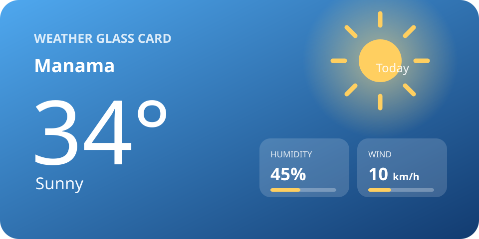

# Weather Glass Card

A responsive, animated Lovelace weather card for Home Assistant. The design pairs a large, lightweight temperature and drawn SVG condition icon with compact humidity and wind tiles. The background and canvas animation adapt to the current weather.

**Author:** Vinoth Sakthivel · [vinoth@kandiyar.com](mailto:vinoth@kandiyar.com)



## Install with HACS

Add Weather Glass Card to HACS as a **Dashboard** repository. This is a Lovelace card, not a Home Assistant integration; choosing **Integration** can cause HACS to look for a `manifest.json` file.

1. In Home Assistant, open **HACS** and select the three-dot menu in the upper-right corner.
2. Choose **Custom repositories**.
3. Enter [`https://github.com/KANDIYARR/weather-glass-card`](https://github.com/KANDIYARR/weather-glass-card), select **Dashboard** as the category, then select **Add**.
4. Find **Weather Glass Card** in HACS and download it.
5. Open **Settings → Dashboards → ⋮ → Resources** and add `/hacsfiles/weather-glass-card/weather-glass-card.js` as a **JavaScript module**. If you already added `/local/weather-glass-card.js`, remove or disable that old resource to avoid loading the stale copy.
6. Save, hard-refresh Home Assistant, then add **Weather Glass Card** to a dashboard and choose a `weather.*` entity.

HACS downloads and updates the card files. Add the HACS resource once; you do not need to copy the JavaScript file yourself.

### Manual installation

If you prefer not to use HACS:

1. Copy `weather-glass-card.js` to `/config/www/weather-glass-card.js`.
2. Open **Settings → Dashboards → ⋮ → Resources**, add `/local/weather-glass-card.js` as a **JavaScript module**, and save.
3. Hard-refresh Home Assistant. On most browsers use **Ctrl+Shift+R**; on macOS use **Cmd+Shift+R**.

## Example

```yaml
type: custom:weather-glass-card
entity: weather.forecast_home
name: Manama
show_humidity: true
show_wind: true
show_forecast: false
animation: true
temperature_unit: auto
size: compact # compact, medium, or large
```

`temperature_unit: auto` uses the entity's temperature unit. Set it to `°C` or `°F` to override the display unit.

The `name` is a per-card label, so separate cards can display different location names while reading from their respective weather entities.

| Option | Default | Description |
| --- | --- | --- |
| `entity` | Required | Home Assistant weather entity, such as `weather.forecast_home` |
| `name` | Entity name | Optional location name shown on the card |
| `show_humidity` | `true` | Show the humidity tile when the entity provides humidity |
| `show_wind` | `true` | Show the wind tile when the entity provides wind speed |
| `show_forecast` | `false` | Request and show a compact five-day forecast |
| `animation` | `true` | Animate the weather background; animation pauses off-screen and respects reduced-motion preferences |
| `temperature_unit` | `auto` | Use the entity's unit (`auto`) or select `°C` or `°F` |
| `size` | `medium` | Card layout: `compact`, `medium`, or `large`; each size scales with the dashboard column width |

## Preview weather conditions

For a quick visual check, open **Developer Tools → States**, select your weather entity, and temporarily set its state to one of these conditions:

`sunny`, `partlycloudy`, `cloudy`, `rainy`, `pouring`, `lightning`, `lightning-rainy`, `snowy`, `snowy-rainy`, `clear-night`, `fog`, `windy`, `windy-variant`, `hail`, or `exceptional`.

The entity's existing temperature, humidity, and wind attributes remain in use. A real integration may overwrite a temporary state change on its next update. For a persistent demo, create a template weather entity with a selectable condition and sample values.

## Notes

- Forecasts are requested with Home Assistant's `weather.get_forecasts` action and appear only when the selected entity provides daily forecasts.
- Rain, storm, snow, cloud, sun, night, fog, wind, and hail effects are drawn on a small canvas. The card caps canvas resolution at 2× device pixel ratio and pauses rendering while off-screen or while the browser tab is hidden.
- If the entity is `unknown`, `unavailable`, or has no temperature, the card displays **Weather unavailable**.
